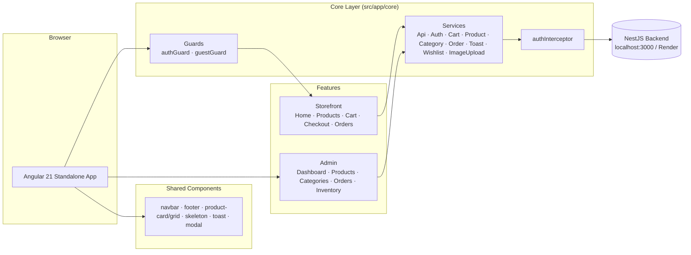
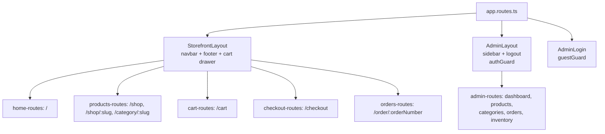
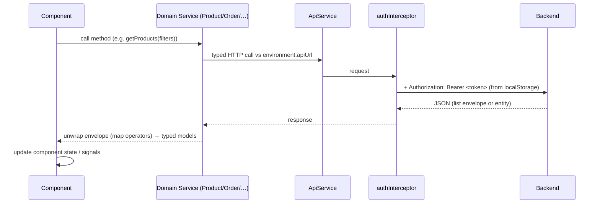

# Architecture

## System Overview

## Bootstrap Chain

`main.ts` → `bootstrapApplication(App, appConfig)` where `app.config.ts` provides:

- `provideBrowserGlobalErrorListeners()`
- `provideZoneChangeDetection({ eventCoalescing: true })`
- `provideRouter(routes)`
- `provideHttpClient(withInterceptors([authInterceptor]))`

The root `App` component is just `<app-toast>` (global toasts) + `<router-outlet>`.

## Routing Architecture

Two layout shells, each lazy-loading feature route files (`loadChildren` + `export default`):

## State Management

No state library — three patterns coexist, all persisted where appropriate:

| Concern  | Pattern                           | Persistence                |
| -------- | --------------------------------- | -------------------------- |
| Cart     | `BehaviorSubject` (items + drawer) | `localStorage('cart')`     |
| Auth     | `BehaviorSubject<User>` + token   | `localStorage('token')`    |
| Wishlist | Angular `signal<number[]>`        | `localStorage`            |
| Toasts   | `BehaviorSubject<Toast[]>`        | —                          |

## Request Flow

Errors are handled per-call-site: components subscribe and route errors to `ToastService` (there is no global error interceptor).

## Styling

Tailwind CSS 4 via `@import 'tailwindcss'` with `@theme` tokens in `src/styles.css`:

- **Fonts**: Cinzel (display/serif) + Outfit (sans) from Google Fonts
- **Palettes**: `gold-50…900` (brand gold `#c5a880`) and `charcoal-50…950` (inverted — 950 is the white page background)
- Component styles are inline Tailwind utilities in templates; angular.json enforces 4–8kB component style budgets.
